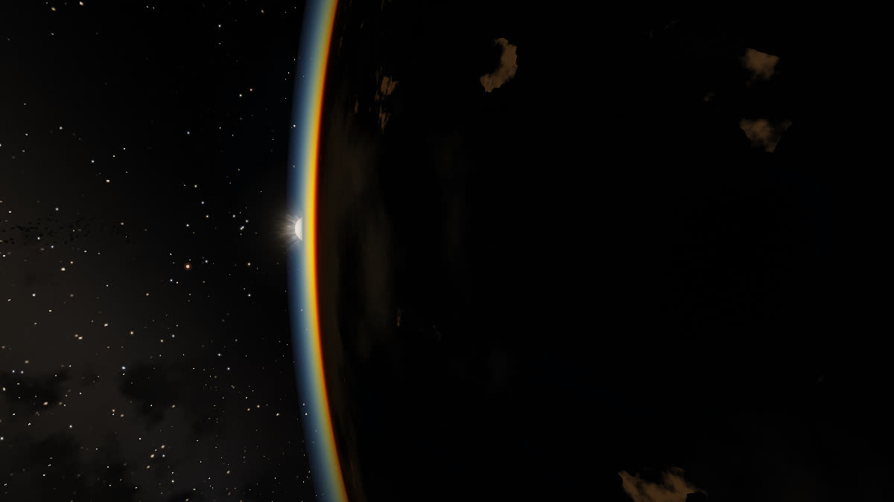
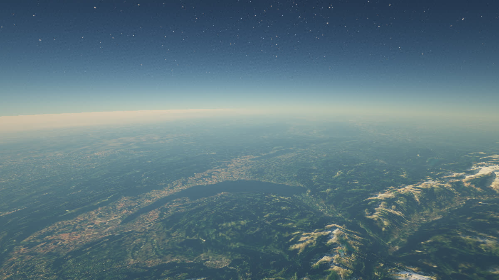
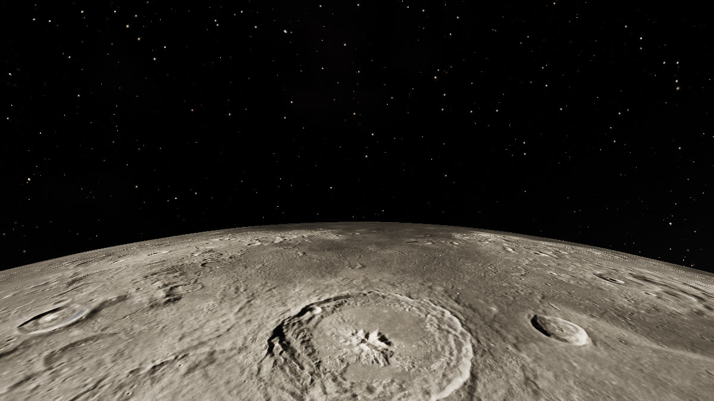
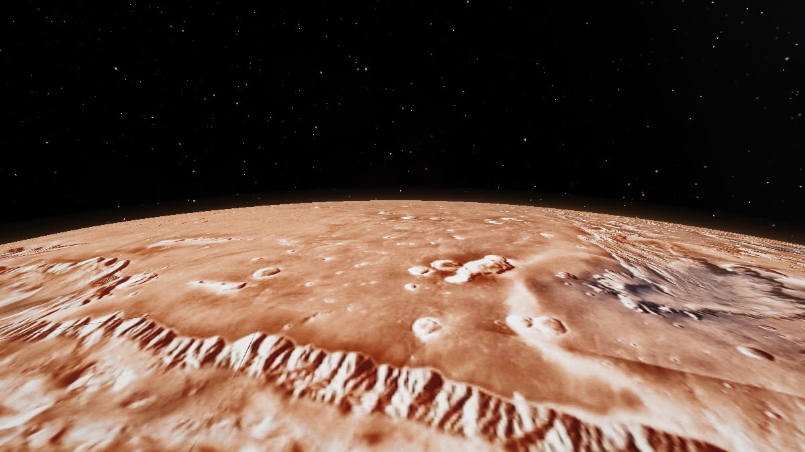
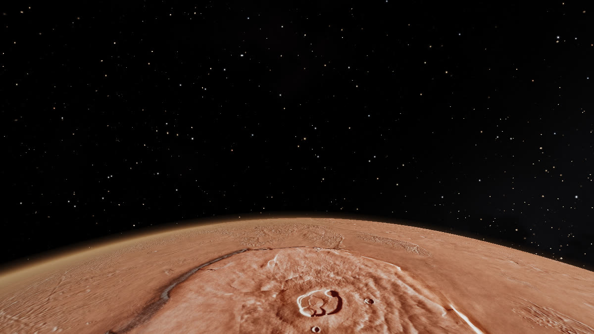
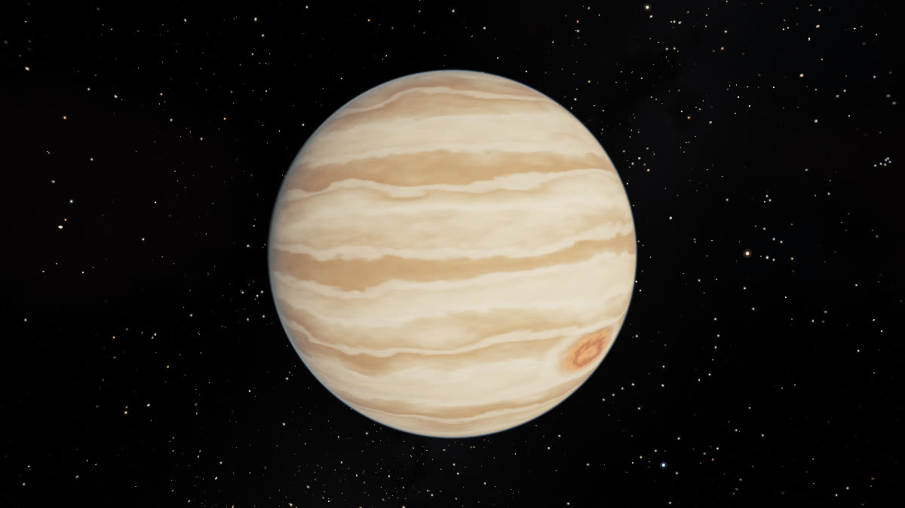
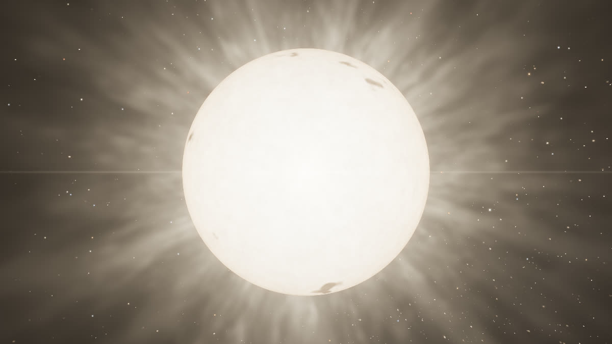
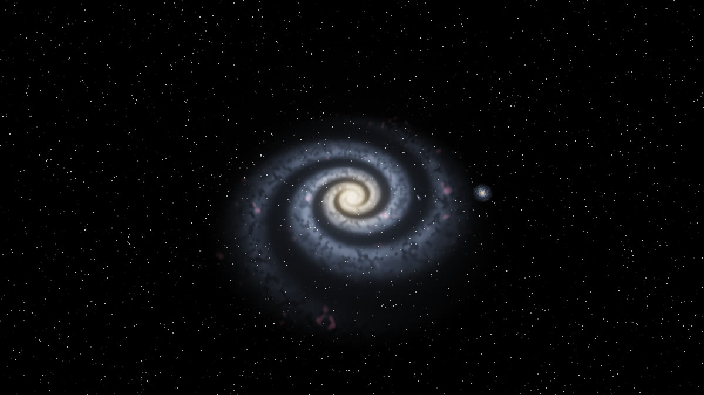
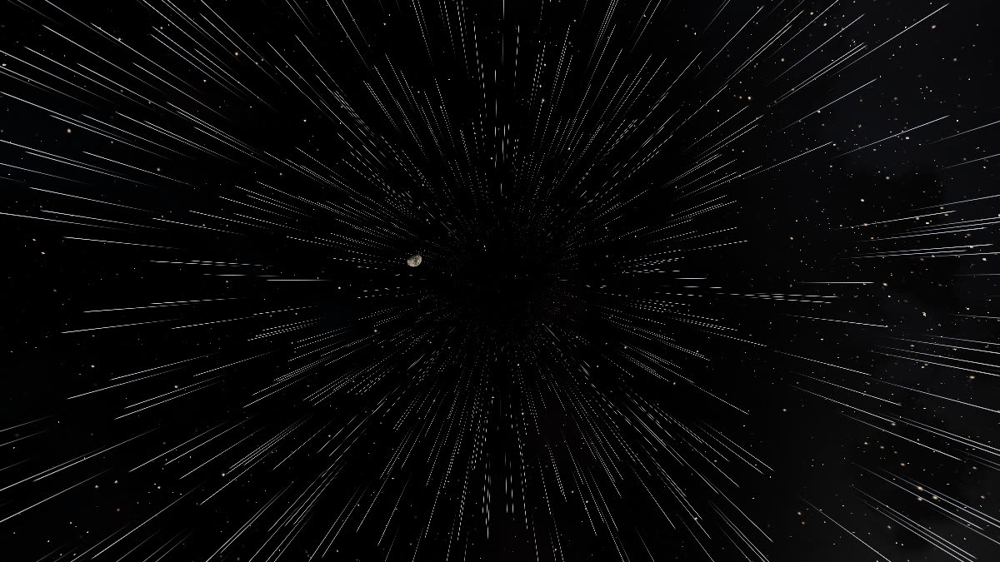
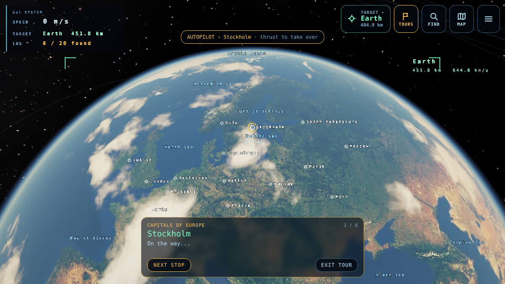

# SpaceTrotter

**Explore the real Solar System in your browser.** Fly your own ship from orbit down to the ground: over real
satellite imagery of Earth, the Moon and Mars, past planets sitting where they really are today, out to 900
real stars and other galaxies. Take a guided tour, find any city or crater, warp to another star, or just
take pictures.

<p align="center">
  
  
  
  
</p>

## Play

| | |
| --- | --- |
| ▶ **Play in the browser** | **https://kmatiq.github.io/SpaceTrotter/** |
| ⬇ **Download the game (one file)** | **[spacetrotter.html](https://kmatiq.github.io/SpaceTrotter/spacetrotter.html)**: right-click → *Save link as…*, or in the game ☰ → **Download game file**. Double-click the file to play. |

- **Domain:** spacetrotter.app is the planned home; for now it lives on GitHub Pages.
- **Browsers:** needs WebGPU. That means desktop Chrome or Edge, Chrome on Android 12+, or Safari on
  iOS/iPadOS 26+.
- **Offline:** the downloaded file contains the whole game (~345 KB). The real satellite maps stream from free
  public servers, so they need an internet connection; offline you get procedural surfaces.
- **First visit:** a welcome screen and a 2-minute interactive tutorial teach the controls. Replay it from
  ☰ → *Replay tutorial*.

## Gallery

<p align="center">
  
  
  
  
  
  
  
  
  
</p>

*All screenshots are rendered by the game itself, here in a software WebGPU renderer at 1200×675. A real GPU
renders at your screen's full resolution.*

## What you can do

- **Fly anywhere:** 6-degrees-of-freedom flight with no gimbal lock. Supercruise between planets, then
  re-enter the atmosphere (with a plasma sheath) and fly low over the ground with the same free controls and an
  afterburner. You can land.
- **Real places:** about 200 landmarks: European capitals and big cities, famous mountains, oceans and seas,
  dark-sky sites, the Apollo sites, lunar craters, Olympus Mons and the Mars rover sites. **FIND** lets you browse by
  category (Solar System, Earth by region, the Moon, Mars, stars, galaxies, night sky) or search everything,
  and **GO** flies you there by autopilot.
- **Famous landmarks in 3D:** the Eiffel Tower, the Giza pyramids, the Colosseum, Big Ben and Westminster, the
  Statue of Liberty, the Taj Mahal, Burj Khalifa, the Golden Gate Bridge, Christ the Redeemer and Stockholm City
  Hall: simplified models at real size (1/5 like the planet), floodlit at night. The **Icons in 3D** tour visits
  them all.
- **Night-sky trips:** pick a constellation under FIND → Night sky. The autopilot flies you to a famous dark-sky
  site (Abisko, La Palma, Mauna Kea, Atacama, Lake Tekapo) on the night it stands highest; on arrival night falls,
  the view turns up to it and photo mode shows just the sky. **BACK TO TODAY** restores the date.
- **Guided tours:** twelve tours: Icons in 3D, Capitals of Europe, Nordic Capitals (with Helsinki in 3D), Nordic Nature,
  Roof of the World, Natural Wonders, Wonders Built by People, Fire Mountains (Earth, Mars and Io), Footsteps on
  the Moon, The Red Planet, Moons of the Giants and Grand Tour. The ship flies itself, circles each stop, lights
  night-side stops and tells you the story.
- **Live system map:** the camera flies out of the ship to a 3D overview of the Solar System with today's
  real planet positions. Tap a planet to cruise there.
- **Stars and galaxies:** 911 real stars (the real constellations), tap any star to **warp**: a ~13 s
  hyperspace jump with streaks and a light tunnel. There are generated star systems (real exoplanets where they
  exist, such as TRAPPIST-1, Proxima b and 51 Pegasi b), a **galaxy view** of the Milky Way and the Local
  Group, and intergalactic jumps to Andromeda.
- **Real 3D city:** Helsinki's real buildings (the city's open LOD2 3D model), streamed live and placed on the
  1/5-scale Earth on the city's own aerial photo, with window façades and lit windows at night. On by default;
  ☰ → 3D buildings turns them off (or open the game with `?nocity`).
- **Constellations:** in Earth's atmosphere at dusk and night, the 34 best-known constellations are drawn
  over the real stars, with names and a fact for the one you look at. `C` or the menu: auto / always / off.
- **Photo mode:** hides everything and saves a PNG.
- **Explorer passport:** stamps for every place you fly low over, every constellation you spot at night, every
  world you log and every tour you finish. Ranks from Cadet to Legend and 15 badges (Moonwalker, Zodiac,
  Interstellar, Real City...). ☰ → Explorer passport; progress is saved in the browser.

## Controls

**Phone / tablet:** left thumb = move stick (anywhere on the left half), drag the right half = look. Tap a
planet or label to target it. Buttons: CRUISE, BOOST, UP/DOWN, ROLL, and at the top TARGET, TOURS, FIND, MAP
and ☰.

**Keyboard and mouse:**

| Key | Action |
| --- | --- |
| `W` / `S`, `A` / `D`, `Space` / `X`, `Q` / `E` | thrust / brake, strafe, up / down, roll |
| Mouse (click to capture) or arrow keys | look |
| `Shift` | boost (an afterburner near the ground) |
| Click a body, `T` (list), `Tab` | choose target |
| `F` | supercruise to the target |
| `/` | find a place |
| `N` | system map |
| `V` | chase camera |
| `P` | photo mode |
| `C` | constellations: auto (night sky) / always / off |
| `M` | sound |
| `G` | performance stats |
| `B` | 60 s GPU benchmark |
| `H` | hint bar |

## Real data, and how accurate it is

| | Source | Notes |
| --- | --- | --- |
| Earth imagery | [Sentinel-2 cloudless 2023](https://s2maps.eu) by EOX (Copernicus Sentinel data) | 10 m/px, to zoom 13. **CC BY-NC-SA 4.0, non-commercial** |
| Earth elevation | [AWS Terrain Tiles](https://registry.opendata.aws/terrain-tiles/) (Mapzen Terrarium) | to zoom 12 |
| Moon imagery / heights | [NASA Moon Trek](https://trek.nasa.gov/moon/): LRO WAC mosaic / LRO LOLA DEM | heights to zoom 5 |
| Mars imagery / heights | [NASA Mars Trek](https://trek.nasa.gov/mars/): Viking MDIM 2.1 / MOLA 128+64 merge | heights to zoom 5 |
| Planet positions | NASA/JPL "Approximate Positions of the Planets" (Standish) | today's date, ~0.1° accuracy 1800–2050 |
| Moon | low-precision lunar theory | real phase and position |
| Constellation lines | [d3-celestial](https://github.com/ofrohn/d3-celestial) by Olaf Frohn (BSD-3-Clause) | 34 famous constellations |
| Stars | [HYG database v4.1](https://github.com/astronexus/HYG-Database) (CC BY-SA) | every star brighter than mag 4.5, with distance |
| Galaxies | galactic coordinates, distances, position angles | Milky Way frame tied to the ecliptic |
| Helsinki aerial photo | City of Helsinki orthophoto 2025, via the [kartta.hel.fi](https://kartta.hel.fi) open-data WMS | zoom 14–18 (to ~0.3 m/px), **CC BY 4.0** |
| Helsinki buildings | [City of Helsinki 3D city model](https://www.hel.fi/en/decision-making/information-on-helsinki/maps-and-geospatial-data/helsinki-3d), LOD2 3D Tiles | **CC BY 4.0**, streamed from kartta.hel.fi; scaled 1/5 like the Earth |

**Deliberate compromises, for playability:**
- **Distances:** orbit distances are compressed. Directions are exact; distance follows `au^0.55`.
- **Sizes:** planets keep their real size *ratios* but Earth is 1/5 scale.
- **Relief:** Earth's mountains are about 2× steeper, so they read at this scale.
- **Time:** in the default fast mode one second is 6 hours. ☰ → *Orbits: real time* switches to the real clock,
  which also gives the real day/night line.
- **Generated content:** gas-giant bands, star systems without known planets and the spiral-arm detail of the
  galaxies are generated.

## How it was built

SpaceTrotter (first called SpaceRoam) was built over a few days in an iterative conversation with **Claude Code** (Anthropic): about 55
commits, each one tested in a headless browser and then played by a human on desktop and on a Galaxy Fold. It
started from a single brief:

> A real-time WebGPU solar-system game in one self-contained React component, with no 3D, physics or asset
> libraries and everything procedural: Float64 world positions with camera-relative rendering, reversed-Z,
> quaternion 6DoF, a data-driven star-system registry, one uber-shader for all spherical bodies, SDF
> raymarching for stations and asteroids, zero per-frame allocations, supercruise, a HUD and a GPU benchmark.

From there it grew in steps, each driven by play-testing feedback:

1. **Engine (day 1):** ray-traced planets with atmosphere scattering, rings, corona, SDF stations, the
   benchmark, GitHub Pages deploy, touch controls, the exploration log, procedural audio, single-file build.
2. **Down to the surface:** a GPU height probe for exact collision and landing, a co-rotating frame, streamed
   real imagery and elevation (Earth, then the Moon and Mars), re-entry effects, a flight HUD with an
   artificial horizon, and adaptive resolution for phones.
3. **UX:** tap-to-target with lock-on, icon buttons, a target list, a live 3D system map that flies out of the
   ship, landmarks with search and autopilot, photo mode, a sharp full-resolution HUD layer, and the tutorial.
4. **Beyond:** real stars with parallax, warp (rebuilt twice after feedback), the galaxy view, real JPL planet
   positions, real size ratios, 911 HYG stars.
5. **Tourism:** guided tours with story cards, orbiting cameras and tour lighting.

Things that were tried and **removed** after testing: live weather clouds (looked worse than procedural),
procedurally generated city blocks (too noisy), and an early warp with glowing "starbow" rings.

## Architecture

Everything lives in one file, [`src/SpaceTrotter.jsx`](src/SpaceTrotter.jsx) (~2,200 lines): a pure-WebGPU engine with
one WGSL module plus a small React layer for the UI.

- **Precision:** all positions are Float64 on the CPU and become camera-relative f32 each frame. Spheres are
  ray-traced in the fragment shader (no meshes), using a cancellation-free quadratic with the altitude computed
  in f64. Depth is reversed-Z with an infinite far plane. The ship lives in its reference body's frame
  (sphere-of-influence switching), so there's no jitter from 1 m to 26 Gm.
- **One spherical-body uber-shader** draws every star, planet and moon from 16 `vec4` uniforms:
  - Terrain: fbm with analytic derivatives, craters, oceans and caps, plus a heightfield raymarch near the
    ground for real silhouettes.
  - Gas giants: bands and storms.
  - Stars: granulation and a volumetric corona.
  - Atmosphere: single-scattering Rayleigh and Mie.
  - Also: a cloud shell with shadows, city lights, GGX ocean glint, and rings with shadows both ways.
- **Map streaming:** tiles go into a 256-layer `texture_2d_array` with an open-addressing GPU hash. The hash is
  updated in queue order with each upload, so the GPU never sees a stale slot, and visible tiles are never
  evicted. Elevation tiles are decoded by exact pixel. Moon and Mars DEMs are filled and smoothed on the CPU
  and uploaded as 16-bit.
- **SDF uber-shader:** raymarches stations, asteroids, the comet nucleus and the ship. The comet tail and warp
  are additive passes.
- **Post:** bloom, an occlusion-tested sun glare, re-entry plasma, warp streaks and tunnel, and ACES tone
  mapping.
- **HUD:** instanced antialiased segments, circles and outlined glyphs, drawn on its own full-resolution
  canvas.
- **UI:** a React/DOM overlay with buttons, the target list, search, tours, maps and the tutorial. It polls the
  engine about 8 times a second.
- **Zero per-frame allocations** in the render loop: preallocated typed arrays, reused descriptors, and number
  formatting into a byte buffer.

## Develop

```bash
npm install
npm run dev        # open the printed URL in Chrome
npm run build      # dist/ (site) + dist/spacetrotter.html (single file)
npm run size       # size report
```

```jsx
import SpaceTrotter, { registerStarSystem, STAR_SYSTEMS } from './SpaceTrotter.jsx';
<SpaceTrotter systemId="sol" onReady={(api) => api.flyTo('earth', 45.8, 6.9, 9000, -12)} />
```

- **Engine API:** `flyTo`, `teleport`, `setTarget`, `cruiseTo`, `goPlace`, `warpTo`, `tourStart`, `mapOpen`,
  `galaxyOpen`, `capture()` (PNG of the next frame), `startBenchmark`, `switchStarSystem`, and more.
- **Testing hooks:** `?headless` renders off-screen for automated tests, `?tutorial` forces the tutorial on,
  and `&tutstep=N` jumps to a step. ☰ shows the build version.

**Size:** source 273 KB (about 33 KB of it is the HYG star catalogue), 200 KB minified, **81 KB gzip**, and
345 KB as the single HTML file with React included.

## Verification

- **Tested:** every feature was tested in headless Chromium with SwiftShader (software WebGPU), with
  screenshots, numeric checks and scripted UI flows, then play-tested on desktop Chrome and on an Android
  Galaxy Fold.
- **Checked against reality:** the subsolar point, Earth's heliocentric longitude and the Moon's phase match
  reality for the test date.
- **Not yet measured:** GPU timings on a dedicated GPU (run `B`).

## Known limitations

- **Earth detail:** imagery stops at 10 m/px, so no individual buildings; ground detail is soft below about
  2 km.
- **Scale:** Earth is 1/5 scale, so real places look about 5× smaller than in reality.
- **Network:** real maps need the network, and the free tile servers aren't meant for heavy public traffic.
  The Earth imagery licence is non-commercial.
- **Accuracy:** moons other than Earth's Moon and the stations have invented orbits. There are no
  moon-on-planet eclipse shadows.
- **Browsers:** WebGPU is required.

## Roadmap

Planned work, roughly in order of priority:

- **Reworked sound:** a full sound redesign (engine, boost, cruise, warp, interface, atmosphere), tuned by ear.
  The cruise and warp arrival whooshes are already done.
- **New 3D ship model:** a custom ship designed in Blender, loaded as a glTF model. The same model loader will
  later bring stations and famous landmarks.
- **Reworked flight controls:** a better flight feel overall, including a smoother atmospheric entry. Some
  jerkiness remains; suspects are the re-entry camera shake, hard braking from the altitude speed cap and
  field-of-view changes during boost.
- **More guided tours:** six new tours are in; next, richer information at every stop: history, science and fun facts.
- **Quizzes and games:** quizzes about the places you visit, photo challenges, a travel journal with stamps
  and achievements.
- **Reworked galaxies:** a more detailed Milky Way with its real arm structure, more star systems to visit, and
  better-looking galaxies of the Local Group.
- **Alternative sci-fi universes:** fictional star systems and worlds to explore, next to the real Solar
  System.
- **And more:**
  - A date & time control for watching eclipses and alignments.
  - More real 3D cities (Helsinki is done), OpenStreetMap buildings elsewhere (Cesium OSM Buildings), plus
    models of famous landmarks.
  - More real moons (Io, Europa, Ganymede, Callisto, Titan, Enceladus, Phobos, Deimos).
  - A custom domain at spacetrotter.app.
