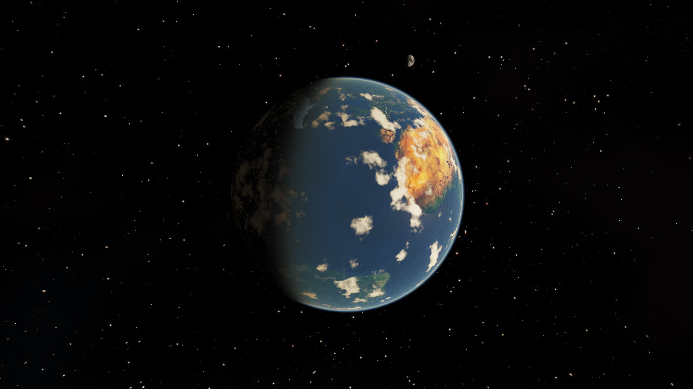
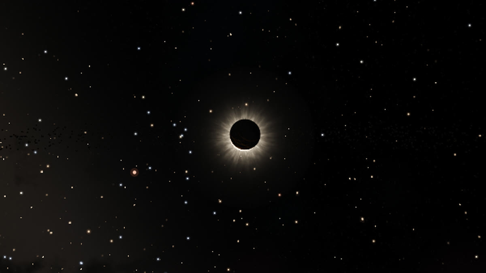
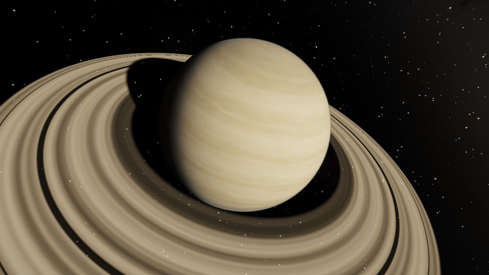

# SpaceTrotter

**The real Solar System in your browser, in under 170 KB.**

Fly your own ship from orbit down to street level: real satellite imagery and terrain, real 3D cities, planets
where they are today, 900 real stars and other galaxies. No install, no account. It runs on phones too.

**▶ Play: https://kmatiq.github.io/SpaceTrotter/** · [Download as one file](https://kmatiq.github.io/SpaceTrotter/spacetrotter.html) (435 KB, double-click to play)

<p align="center">
  
  
  
  
</p>

## Tiny

The whole game (engine, shaders, UI and data) is **one 447 KB JavaScript file, 167 KB gzipped**. There are no
textures, models or libraries to download apart from React. Everything you see is either generated on the GPU
(WebGPU) or streamed as open data while you fly.

## What you can do

- Fly anywhere from orbit to the ground, with real day, night, sunsets and city lights.
- Explore 3D buildings worldwide, Helsinki's detailed city model, 10 famous landmarks, and sun shadows.
- Turn on photorealistic 3D cities with `?g3d` (test).
- Take guided tours, search for places, and look up constellations from a dark spot on Earth.
- Collect passport stamps and badges.
- Warp to other stars and galaxies.
- Use photo mode.

**Controls:** WASD + mouse (`F` supercruise, `/` find, `N` map, `P` photo, `H` help). On phones: a stick on the
left, look on the right.

## Data sources

| Data | Source | Licence |
| --- | --- | --- |
| Earth imagery | [Sentinel-2 cloudless 2023](https://s2maps.eu), EOX / Copernicus | CC BY-NC-SA 4.0 |
| Earth terrain | [AWS Terrain Tiles](https://registry.opendata.aws/terrain-tiles/) (Mapzen Terrarium) | open data |
| Night lights | [NASA Black Marble](https://earthdata.nasa.gov/) (GIBS) | NASA, public |
| Moon / Mars imagery and heights | [NASA Moon Trek](https://trek.nasa.gov/moon/) (LRO) / [Mars Trek](https://trek.nasa.gov/mars/) (Viking, MOLA) | NASA, public |
| Buildings worldwide | [Cesium OSM Buildings](https://cesium.com/platform/cesium-ion/content/cesium-osm-buildings/) via Cesium ion | © OpenStreetMap contributors, ODbL |
| Photorealistic 3D (`?g3d`) | [Google Photorealistic 3D Tiles](https://developers.google.com/maps/documentation/tile/3d-tiles) via Cesium ion | © Google and data providers |
| Helsinki 3D model and aerial photo | [City of Helsinki](https://kartta.hel.fi) | CC BY 4.0 |
| Planet positions | NASA/JPL approximate planetary positions (Standish) | public |
| Stars | [HYG database v4.1](https://github.com/astronexus/HYG-Database) | CC BY-SA |
| Constellation lines | [d3-celestial](https://github.com/ofrohn/d3-celestial) | BSD-3-Clause |
| Draco decoder (Helsinki tiles) | [Google Draco](https://github.com/google/draco) | Apache-2.0 |

Credits for streamed data are shown on screen while that data is visible. The Earth imagery and the free Cesium
ion plan are for **non-commercial use**.

## Develop

```bash
npm install
npm run dev     # http://localhost:5173
npm run build   # dist/ + dist/spacetrotter.html (single file)
```

Almost everything lives in `src/SpaceTrotter.jsx`. URL flags: `?noosm`, `?nocity`, `?noshadow`, `?g3d`.
